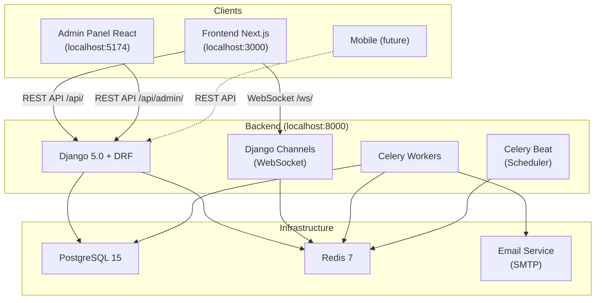
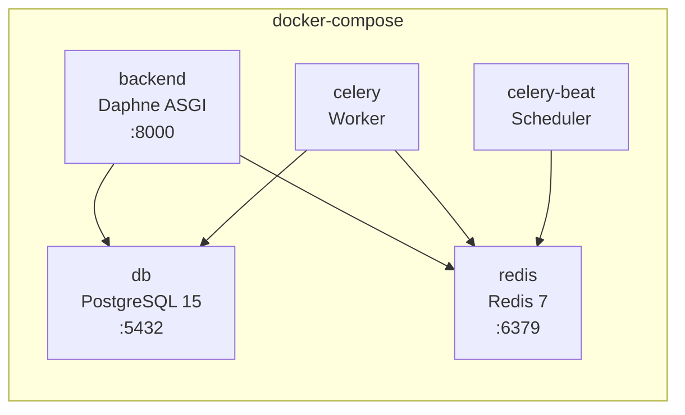
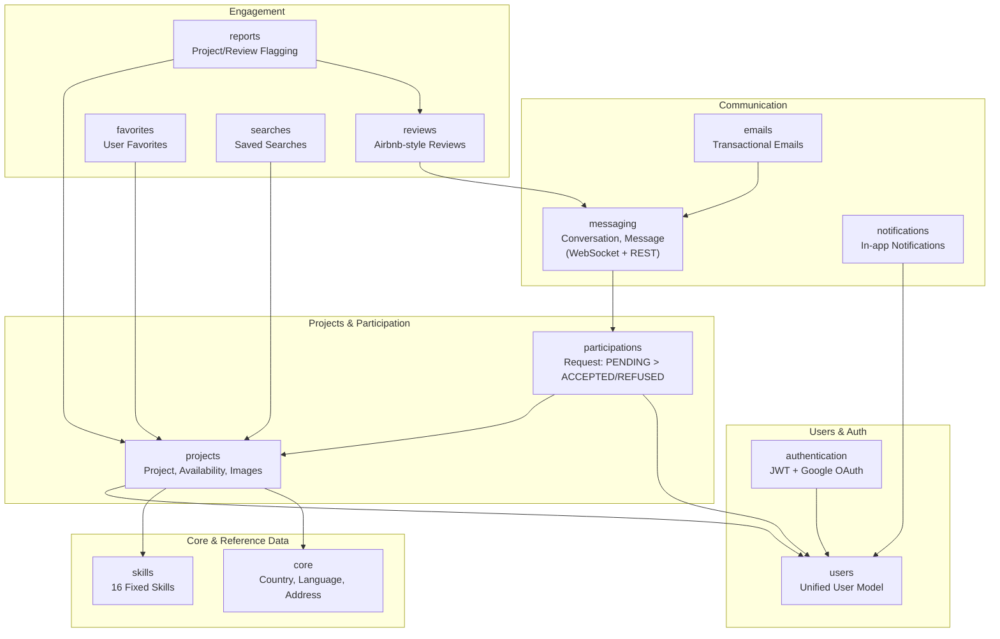
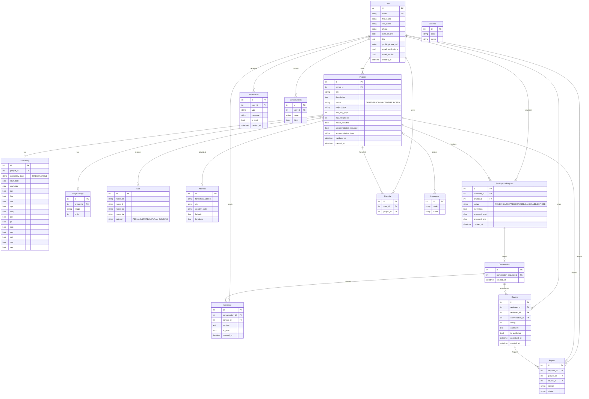
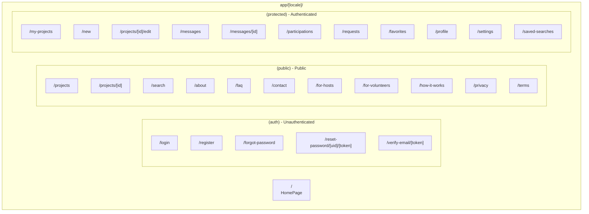
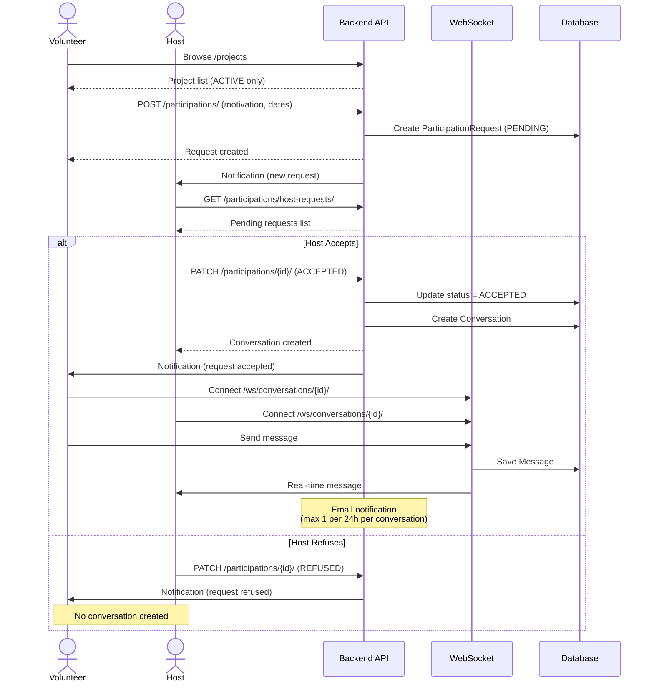
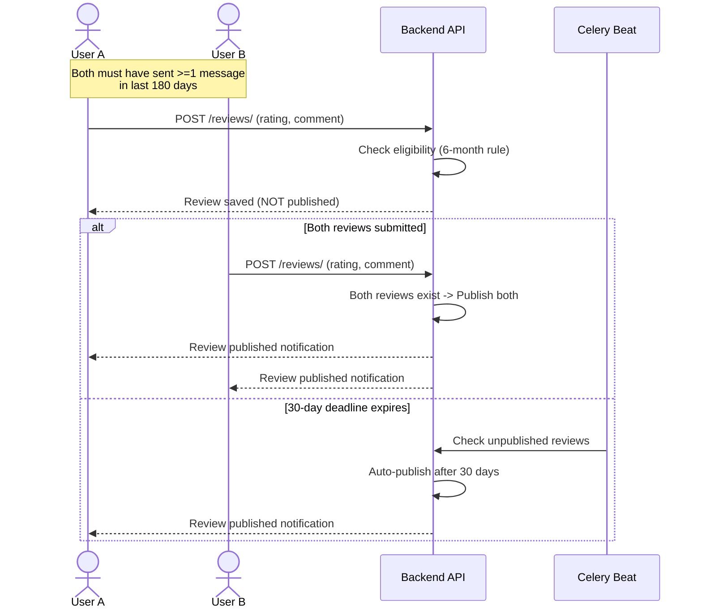
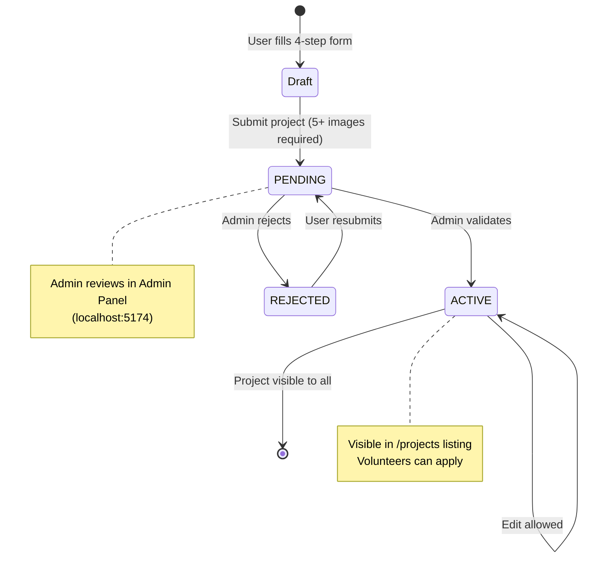
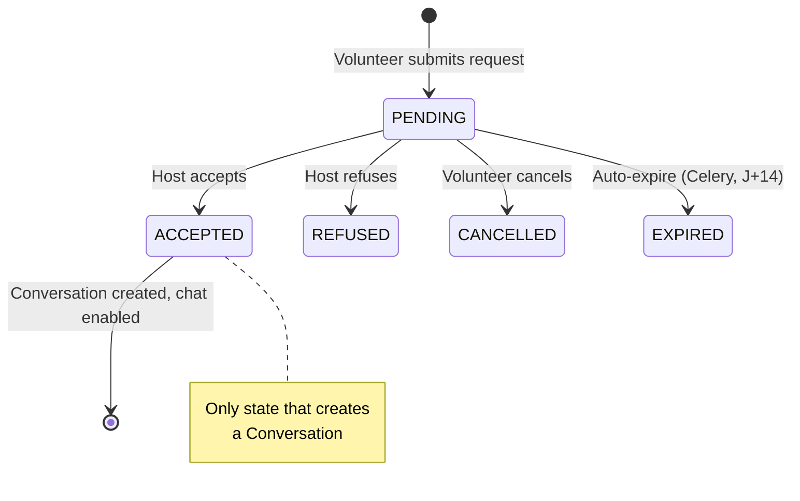
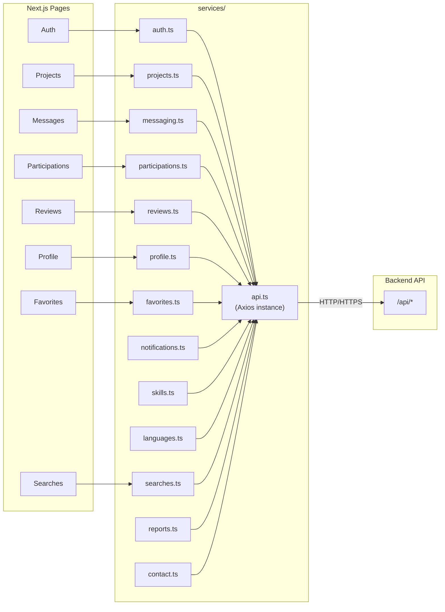

# Ecobilda - Architecture Diagrams

## High-Level Architecture

## Docker Services

## Backend Django Apps

## Database Models (Entity Relationship)

## Frontend Next.js Pages (App Router)

## User Flows

### Participation & Messaging Flow

### Review Publication Flow (Airbnb-style)

### Project Creation & Validation

### Participation Request States

## Frontend Services Layer

